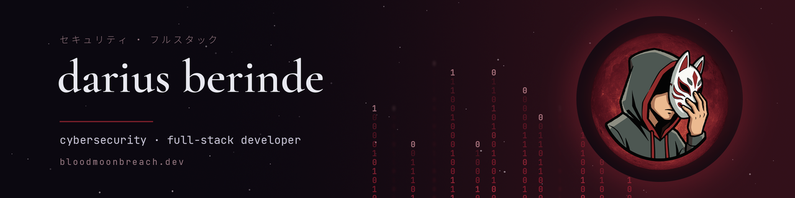
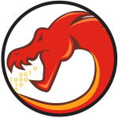

 

·  `セキュリティ`  ·  `bloodmoonbreach.dev`  ·  `フルスタック`  ·

###  アバウト  about

I'm passionate about cybersecurity and full-stack development, and I put the hours in: labs on Hack The Box and TryHackMe, a home lab on a NAS, and tools I design myself and build with AI-assisted development (Claude Code). Everything I learn ends up as a writeup at [bloodmoonbreach.dev](https://bloodmoonbreach.dev).

&nbsp;&nbsp;&nbsp;&nbsp;&nbsp;&nbsp;

---

### プロジェクト  projects

- [**mikazuki**](https://github.com/bloodmoonbreach/mikazuki) 三日月 · A self-hosted job-search desk: collects offers from company job systems, checks where a "remote" job can really be done from, builds every CV from one fact file, and prepares applications without ever pressing Submit.
- [**remote-check**](https://github.com/bloodmoonbreach/remote-check) · "Can I do this job from where I live?" for 252 countries, in English, Spanish and Romanian. Strips hidden text and prompt injections before reading a post.
- [**cvtracks**](https://github.com/bloodmoonbreach/cvtracks) · One fact file, every CV: one-page PDFs per role and language, a linter, and tailoring that never invents a claim.
- [**bloodmoonbreach.dev**](https://bloodmoonbreach.dev) · My blog: pentest writeups, lab notes, and how the projects above were built.

All three tools are MIT-licensed and run on your own machine.

### いま  now

- Preparing for SOC analyst and junior pentester roles.
- Lab work on Hack The Box and TryHackMe, written up on the blog.
- Running my own automation on a NAS: n8n, Home Assistant and the tools above.

---

### ウェブスタック  web stack

  
  
  
  
  
  
  
  
  
  
  
  
  
  
  

   

### セキュリティ  cybersecurity

  
  
  
  
  
  
  
  
  
  
  
  

   

### ホームラボ  homelab

  
  
  
  
  
  
  
  
